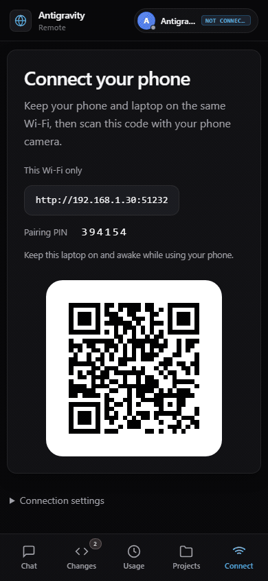
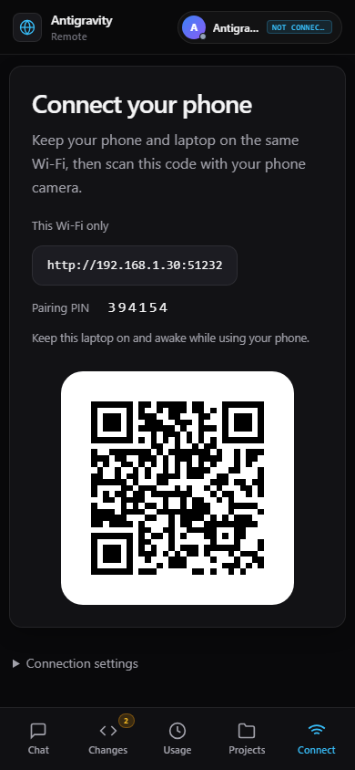
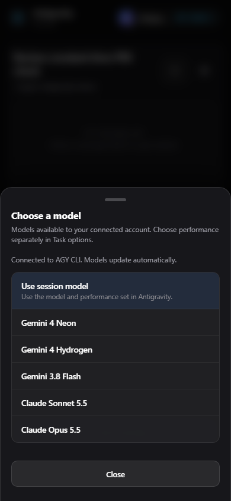
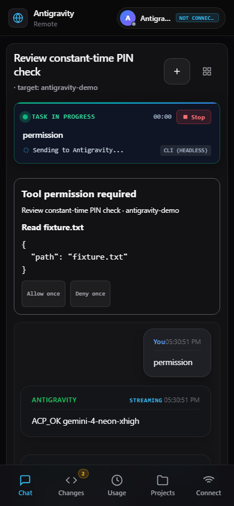
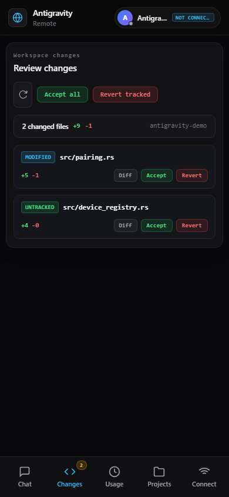

# Antigravity Remote

A lightweight Windows/Rust remote companion for controlling one signed-in Antigravity laptop from a phone on the same Wi-Fi. **Your laptop runs the agent; your phone acts as a remote.**

Built by **Nanda Zhafran Mahendra** as an independent MIT-licensed development prototype proposing native same-Wi-Fi QR pairing with per-device laptop confirmation and revocation for [Google Antigravity Remote Control](https://antigravity.google/docs/remote-control/).

## Walkthrough Preview



| Same-Wi-Fi QR Pairing | Account Model Picker | Live Tool Consent (`agy acp`) | Mobile Git Diff Review |
| :---: | :---: | :---: | :---: |
|  |  |  |  |

## Key Highlights

- **Same-Wi-Fi QR & 6-Digit PIN Pairing:** Scan the QR shown on the laptop to pair directly on the local network (with optional Tailscale mode). Security settings stay laptop-owner-only, and **Sign out all paired phones** rotates the token and revokes active WebSockets immediately.
- **Account-Backed Model & Performance Picker:** Reads exact available models and reasoning variants (`Low`, `Medium`, `High`, `XHigh`) live from your signed-in Antigravity runtime with no hardcoded fallback catalog.
- **Mobile CLI Tool Permission Controls:** Holds native `agy acp` tool permission requests until you approve or deny from your phone, surviving page reloads and preserving keyboard focus.
- **Safe Mobile Git Review:** Review modified and untracked files per conversation workspace, accept individual files or commit all, and revert tracked changes without silently deleting untracked work.
- **Lightweight Native Rust Engine:** Compiles to a single ~4.2 MiB Windows executable (`axum` + `tokio`), requires no external API keys, and passes 166 core automated tests plus 7-viewport headless Chrome checks.

The [November 19 corrective audit and pre-submission follow-up](docs/AUDIT_FOLLOWUP.md) describe the verified fixes and engineering scope. The [earlier release review](docs/GITHUB_HANDOFF_REVIEW.md) covers the UI fixes, test results, and remaining hardware and account checks.

Get the [reviewed source ZIP](https://github.com/nnavyy/antigravity-remote/releases/download/v2.0.0-dev.4/antigravity-remote-source.zip) to build this version on Windows.

## Start the bridge

1. Install stable Rust for Windows and the linker for your toolchain. MSVC uses Visual C++ Build Tools. GNU needs MinGW GCC and dlltool on PATH.
2. Install Antigravity and sign in. CLI mode uses the local `agy` executable. Desktop model and quota discovery uses the separate running Antigravity App.
3. In the extracted folder, run `.\build.bat`, then `.\Start_Antigravity_Remote.bat`. Keep the bridge running. The Connect page opens on the laptop.
4. On the same Wi-Fi, scan the laptop's QR with the phone camera. Follow the pairing prompt. Choose **AGY CLI** in Chat to try the ACP tool permission controls.

**Chat** sends prompts and shows pending tool requests. **Changes** reviews edits in the active chat's project. **Usage** shows the limits the account reports. **Projects** chooses a working folder. **Connect** handles pairing and has a retry action if the laptop is unreachable.

## Run development tests

From the extracted folder, use PowerShell with Rust, its linker, Git, Node.js 22 or later, Python 3.11 or later and Chrome installed. The HTTP and browser tests launch disposable processes and workspaces. Add the MinGW bin directory to PATH before running the tests if you use Rust GNU.

```powershell
python -m venv .venv
.\.venv\Scripts\python.exe -m pip install psutil websockets
cargo fmt --all -- --check
cargo test --all-targets --locked
cargo clippy --all-targets --locked -- -D warnings
node --test tests/client.test.cjs
.\build.bat
.\.venv\Scripts\python.exe tests/smoke.py --binary antigravity-bridge.exe
.\.venv\Scripts\python.exe docs/review/repro/check_permission_browser.py --binary antigravity-bridge.exe --output permission-browser.json
```

The [development report](docs/ANTIGRAVITY_DEVELOPMENT_HANDOFF.md) records verified behavior, test limitations and commands for the optional signed-in checks. The live chat checks use the signed-in account's model quota.

## Author & License

Created by **Nanda Zhafran Mahendra** · Released under the MIT License (`LICENSE`).
